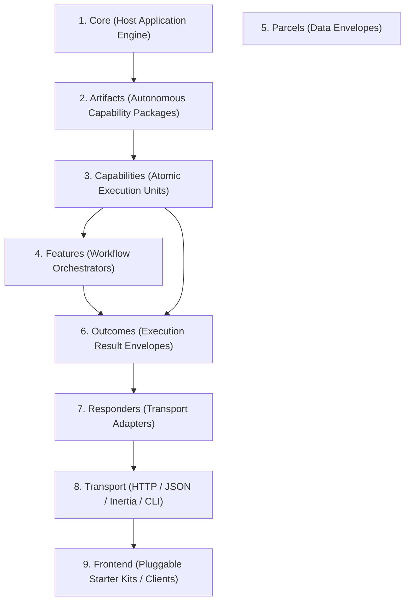
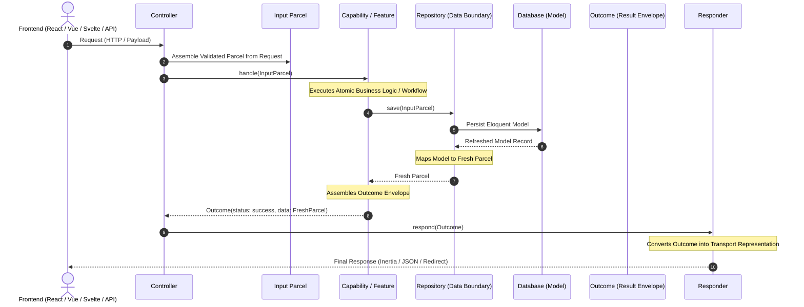

# Artifact-Driven Architecture (ADA)

> [!IMPORTANT]
> **The Official Technical Reference for ADA:**
> **"Artifacts provide capabilities. Features define behavior."**
>
> Artifact-Driven Architecture (ADA) is the concrete architectural implementation of the Ugarit philosophy. It establishes strict layer isolation, guarantees zero-knowledge decoupling between frontend and backend, and structures application logic around autonomous, capability-bearing **Artifacts**.

---

## 1. The Core Architectural Hierarchy

ADA organizes system execution in a strict top-to-bottom pipeline:



### Stage-by-Stage Breakdown

1. **Core:**
   The foundational host application environment (`Heritage\...`). It provides the container, configuration, telemetry, global middleware, security pipelines, and bootstrapping.
2. **Artifacts:**
   Autonomous technical packages residing under `artifacts/<name>/` registered via an `art.php` manifest.
3. **Capabilities:**
   Atomic units of execution responsible for carrying out a single, clearly defined operation (Single Responsibility Principle). Encapsulates persistence, query, mutation, or computational logic.
4. **Features:**
   Comprehensive workflow orchestrators that coordinate across multiple atomic Capabilities within or across artifacts, managing database transactions and data flow.
5. **Parcels:**
   Strongly-typed, validated data envelopes that travel across system layers, preventing leakage of internal Eloquent model state into domain logic.
6. **Outcomes:**
   The standardized result of domain execution. An Outcome is transport-agnostic and encapsulates result status, payloads, errors, and client feedback metadata.
7. **Responders:**
   Boundary translators that convert an agnostic `Outcome` into a specific transport format (Inertia, JSON, Redirect) tailored to client requirements.
8. **Transport:**
   The communication wire protocol (HTTP JSON response, Inertia page props, HTTP redirects, or CLI output).
9. **Frontend:**
   The fluid, pluggable presentation tier (React, Vue, Svelte, Livewire, or mobile apps) operating on the Zero-Knowledge principle.

---

## 2. The Golden Dependency Invariant

$$\mathbf{Feature \longrightarrow Artifact}$$
$$\mathbf{Artifact \;\cancel{\longrightarrow}\; Feature}$$

```text
┌────────────────────────────────────────────────────────┐
│                        FEATURE                         │
│             (Application Workflow Behavior)            │
│                                                        │
│   Composes: Identity Capability + i18n Capability      │
└───────────────────────────┬────────────────────────────┘
                            │
                            ▼ (Allowed: Feature depends on Capabilities)
┌────────────────────────────────────────────────────────┐
│                       ARTIFACT                         │
│             (Independent Technical Unit)               │
│                                                        │
│   Provides: Storage, Identity, i18n, Models, Parcels   │
│                                                        │
│   ❌ NEVER imports or references higher-level Features  │
└────────────────────────────────────────────────────────┘
```

* **Features know Artifact Capabilities:** A feature (e.g., "User Onboarding Flow") imports capabilities from the `identity` artifact, `i18n` artifact, and `storage` artifact.
* **Artifacts NEVER know Features:** An artifact has zero knowledge of consumer features. It exposes contracts, repositories, parcels, and capabilities as autonomous building blocks.

---

## 3. The Zero-Knowledge Principle (Frontend-Backend Decoupling)

* **Backend is Constant:** The domain models, capabilities, parcels, outcomes, and storage pipelines are immutable across client implementations.
* **Frontend is Fluid:** Developers choose any frontend implementation (React, Vue, Svelte, Livewire, Mobile, or CLI).
* **Zero View Code in Artifacts:** Artifacts **never** contain Blade templates, Inertia components, React/Vue assets, or stylesheets.
* **Agnostic Outcomes:** Capabilities and Features return an **`Outcome`**, which the **`Responder`** maps into whatever the current frontend demands.

---

## 4. Anatomical Structure of an Artifact

Each artifact lives in `artifacts/<name>/` and follows this exact layer structure:

```text
artifacts/<artifact-name>/
├── art.php                     # The Primary Artifact Manifest & Binding Descriptor
├── composer.json               # Package identity (ugaritco/<artifact>)
├── database/
│   └── migrations/             # Schema definitions and data migrations
├── src/
│   ├── Capabilities/           # Atomic domain operation executors
│   ├── Contracts/              # Interface boundaries for inter-layer abstraction
│   ├── Enums/                  # Domain constants and typed outcome results
│   ├── Features/               # Multi-step workflow orchestrators
│   ├── Http/
│   │   ├── Controllers/        # Dispatchers only (coordinates run() and respond())
│   │   └── Requests/           # Input validation and Parcel assembly
│   ├── Models/                 # Eloquent persistence models (never leaked outside)
│   ├── Outcomes/               # Standardized operation outcome envelopes
│   ├── Parcels/                # Strongly-typed data envelopes
│   ├── Policies/               # Authorization policies
│   ├── Providers/              # Service providers registering artifact capabilities
│   ├── Repositories/           # Data source boundary mapping Models to Parcels
│   └── Rules/                  # Custom domain validation rules
└── tests/                      # Dedicated Pest test suite
```

---

## 5. Architectural Layer Isolation Rules

| Layer | Type | Invariant & Responsibility |
| :--- | :--- | :--- |
| **`Controller`** | Dispatcher | Accepts HTTP input, triggers request validation, maps to Parcel, executes Capability/Feature via `run()`, and transforms **Outcome** into **Response** via `respond()`. **Zero business logic.** |
| **`Parcel`** | Data Envelope | Strongly typed, immutable data structures representing explicit input and output shapes across boundaries. |
| **`Capability`** | Atomic Execution | Encapsulates a single focused business operation. Accepts a Parcel, interacts with Repositories via Contracts, and returns an **Outcome**. |
| **`Feature`** | Workflow Orchestrator | Coordinates multiple Capabilities or complex multi-step domain workflows within database transactions. |
| **`Repository`** | Data Boundary | Mediates between domain logic and persistence. Maps Models to Parcels. **Never leaks Eloquent Models beyond the repository layer.** |
| **`Model`** | Persistence | Eloquent active record entities. Strictly encapsulated within the artifact's repository layer. |
| **`Outcome`** | Result Envelope | Standardized execution outcome. Contains status (`success`, `failed`, `validation_error`), data payload, and flash metadata. |
| **`Responder`** | Transport Adapter | Formats the **Outcome** into transport representations: JSON, Inertia page props, or HTTP redirects. |
| **`Contract`** | Interface | Defines public contracts for mockability, decoupling, and dependency injection. |

---

## 6. End-to-End Execution Flow



---

## 7. The `art.php` Specification

Every artifact declares its capabilities and dependencies via `art.php`:

```php
<?php

declare(strict_types=1);

namespace Ugarit\Artifacts\Identity;

use Heritage\Support\Artifact;

return new class extends Artifact
{
    /**
     * The unique identifier for the artifact.
     */
    public string $id = 'identity';

    /**
     * The human-readable name of the artifact.
     */
    public string $name = 'Identity & Access Management';

    /**
     * The semantic version of the artifact.
     */
    public string $version = '1.00.00';

    /**
     * The technical capabilities provided by this artifact.
     *
     * @var array<string, string>
     */
    public array $capabilities = [
        'authentication' => 'User authentication, sessions, and token management',
        'authorization'  => 'Role-based access control and policy enforcement',
        'passkeys'       => 'WebAuthn hardware passkey authentication',
    ];

    /**
     * Service providers registered by this artifact.
     */
    public array $providers = [
        Providers\IdentityServiceProvider::class,
    ];

    /**
     * Dependencies on other artifact capabilities.
     */
    public array $requires = [
        // 'i18n.translations',
    ];

    /**
     * Boot logic for the artifact.
     */
    public function boot(): void
    {
        // Capability bootstrap logic
    }
};
```
